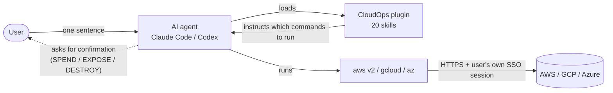
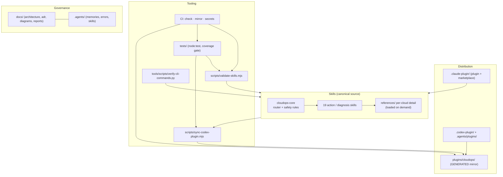
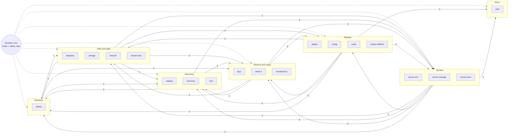
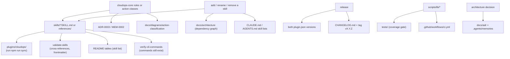

# Architecture Overview

Status: Approved · Last updated: 2026-10-18 · Decisions: see [`../adr/`](../adr/) · Long-term memory: [`../../.agents/memories/`](../../.agents/memories/)

CloudOps Agent Skills is a **declarative plugin**: markdown skills that teach an AI agent to operate AWS, Google Cloud and Azure through their official CLIs. There is no server and no runtime code to deploy. The "system" is the skills, the safety rules they share, and the tooling that keeps them correct.

## 1. System context

Trust boundaries: the plugin never holds credentials; the CLIs use the user's own login session. The agent, not a service, is the confirmation prompt ([ADR-0003](../adr/ADR-0003-safety-model-action-classes.md)).

## 2. Repository layers

| Layer | Contents | Rule |
|-------|----------|------|
| Skills | `skills/<name>/SKILL.md`, `references/*.md` | The only hand-edited source of behaviour |
| Distribution | Claude and Codex manifests, marketplace entries | Versions must match ([`validate-skills`](../../scripts/validate-skills.mjs)) |
| Mirror | `plugins/cloudops/` | **Generated** — never edit; CI fails if stale |
| Tooling | validator, sync, CLI verifier, tests | Pure logic in `scripts/lib/`, thin CLI wrappers |
| Governance | ADRs, memories, error records, reports | Docs follow code; see [ADR-0008](../adr/ADR-0008-adapting-engineering-spec.md) |

## 3. Anatomy of a skill

Every skill has the same shape, so the agent (and reviewers) know where to look:

1. **Frontmatter** — `name` (= directory), `description` with trigger phrases in English and 中文 (≤ 1024 chars). This is what makes the agent load the skill.
2. **Preamble** — which CLIs are allowed, the **safety class**, a pointer to `cloudops-core`.
3. **Workflow** — ask → preflight (READ) → confirm (SPEND / EXPOSE / DESTROY) → run → verify → report.
4. **Per-cloud commands** — AWS, GCP, Azure sections; large ones are split into `references/` (progressive disclosure keeps the loaded context small).
5. **Errors and tips.**

Request lifecycle: [`../diagrams/request-lifecycle.md`](../diagrams/request-lifecycle.md). Action classification: [`../diagrams/action-classification.md`](../diagrams/action-classification.md).

## 4. Skill dependency graph (Impact Graph)

Skills reference each other **by name only** (no shared code). The graph below is generated from the actual text of `skills/`: an edge `A → B` with a number means *N* skills in group A mention a skill in group B. `cloudops-core` is drawn as a hub because it references all 19 other skills and all 19 reference it.

Full adjacency (excluding the `cloudops-core` hub), generated 2026-10-18:

| Skill | References (excluding `cloudops-core`) | Fan-in |
|---|---|---|
| `cloudops-auth` | — | 2 |
| `cloudops-catalog` | — | 4 |
| `cloudops-config` | `deploy`, `logs`, `restart-rollback`, `server-exec` | 6 |
| `cloudops-cost` | `delete`, `metrics` | 2 |
| `cloudops-database` | `catalog`, `config`, `delete`, `network` | 2 |
| `cloudops-delete` | `domain-dns`, `inventory`, `troubleshoot` | 7 |
| `cloudops-deploy` | `auth`, `config`, `database`, `delete`, `domain-dns`, `logs`, `restart-rollback`, `scale`, `server-rent`, `troubleshoot` | 6 |
| `cloudops-domain-dns` | — | 3 |
| `cloudops-inventory` | `cost`, `delete`, `server-manage` | 3 |
| `cloudops-logs` | `server-exec`, `troubleshoot` | 6 |
| `cloudops-metrics` | `restart-rollback`, `scale`, `server-exec` | 4 |
| `cloudops-network` | `config`, `database`, `deploy`, `server-exec`, `troubleshoot` | 3 |
| `cloudops-restart-rollback` | `config`, `deploy`, `logs`, `metrics`, `server-manage`, `troubleshoot` | 4 |
| `cloudops-scale` | `catalog`, `deploy`, `metrics`, `server-manage`, `troubleshoot` | 3 |
| `cloudops-server-exec` | `config`, `logs`, `network`, `troubleshoot` | 6 |
| `cloudops-server-manage` | `catalog`, `delete`, `inventory`, `logs` | 5 |
| `cloudops-server-rent` | `auth`, `catalog`, `delete`, `deploy`, `server-exec`, `server-manage`, `troubleshoot` | 1 |
| `cloudops-storage` | `delete` | 0 |
| `cloudops-troubleshoot` | `config`, `cost`, `deploy`, `domain-dns`, `inventory`, `logs`, `metrics`, `network`, `restart-rollback`, `scale`, `server-exec`, `server-manage` | 8 |

### Findings

- **Hub-and-spoke:** `cloudops-core` ↔ every skill (19 out, 19 in).
- **One large cycle:** excluding the hub, **15 of the 19 other skills form a single strongly-connected component** (e.g. `deploy → logs → troubleshoot → deploy`). Only `auth`, `catalog`, `storage` and `domain-dns` are outside it.
- **Most depended-on:** `troubleshoot` (8), `delete` (7), then `config`, `deploy`, `logs`, `server-exec` (6 each). A rename or removal of these has the widest blast radius.

### Consequences

| Consequence | How it is handled |
|-------------|-------------------|
| The skills cannot be shipped one at a time with every commit passing the cross-reference rule | The cross-reference check is a **PR gate**, not a per-commit gate. Skill commits on a feature branch may only fail with "unknown skill" for skills added later in the same branch ([ADR-0006](../adr/ADR-0006-git-workflow-github-flow.md)) |
| A typo in a skill name would silently break routing | `validate-skills` fails CI on any `cloudops-*` mention that is not a real skill (tested, incl. mutation tests) |
| Renaming a skill touches many files | Rename = update all mentions, `README` tables, `docs/`; the validator lists every stale mention |
| Coupling is soft (names, not code) | Accepted; the alternative — duplicating confirmation rules in each skill — was rejected ([ADR-0002](../adr/ADR-0002-provider-neutral-skills-by-intent.md)) |

## 5. Change-impact graph

Before changing anything, trace what else must move (spec §5). This is the standing impact analysis for this repository:

## 6. Quality gates

| Gate | Where | Fails when |
|------|-------|-----------|
| Structure | `npm run validate` (CI `check`) | Frontmatter, names, cross-references, manifests, upstream branding |
| Unit tests + coverage | `npm run test:coverage` (CI `check`) | Any test fails, lines < 80 % or branches < 70 % on `scripts/lib/` |
| Mirror | CI `mirror` | `plugins/cloudops/` differs from a fresh sync |
| Secrets | CI `secrets` (gitleaks, [`.gitleaks.toml`](../../.gitleaks.toml)) | Any credential-like string in the history |
| Commands exist | `python3 tools/scripts/verify-cli-commands.py all` (**manual**, needs `awscli`, `az`, `shellcheck`) | A command or flag in a skill does not exist |

The command verifier is manual because CI would need the Azure CLI and a slow `--help` probe (~2 min); it is a release gate ([`SKILL-release`](../../.agents/skills/SKILL-release.md)).

## 7. Known limitations

- `gcloud` commands could not be executed or schema-checked in the build environment; they follow Google's documentation and must be reviewed (tracked in [`../../todo.md`](../../todo.md)).
- AWS CLI v2-only customizations (`logs tail`, `sso login`, `configure list-profiles`) are checked against documentation, not run.
- No resource has been created in a real cloud account. An end-to-end run against sandbox accounts is the main open item.
