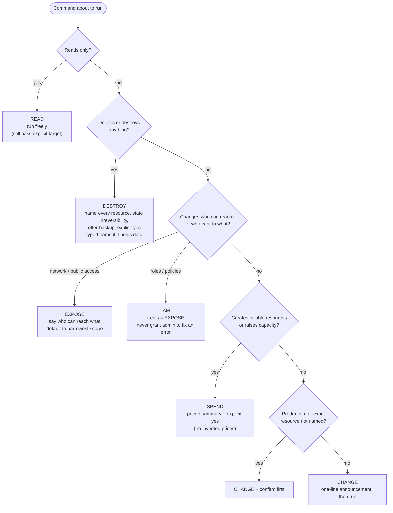

# Action Classification and Required Confirmation

Every command an agent runs is classified before it runs. Definitions live in [`cloudops-core`](../../skills/cloudops-core/SKILL.md); rationale in [ADR-0003](../adr/ADR-0003-safety-model-action-classes.md).

Bypass flags (`--yes`, `--quiet`, `--force`, `--skip-final-snapshot`, `--no-wait` on deletes) are allowed **only** on the paths that already hold an explicit user confirmation.

| Class | Example | Gate |
|-------|---------|------|
| READ | `aws ec2 describe-instances` | none |
| CHANGE | update an env var, restart, roll back, edit DNS | announce (confirm on prod) |
| SPEND | create VM / database, scale up | priced explicit yes |
| EXPOSE | open 443 to the world, public bucket, unauthenticated service | exposure explicit yes |
| IAM | create role, attach policy | exposure explicit yes, narrowest policy |
| DESTROY | terminate VM, drop database, delete resource group | named + backup offer + yes / typed name |
