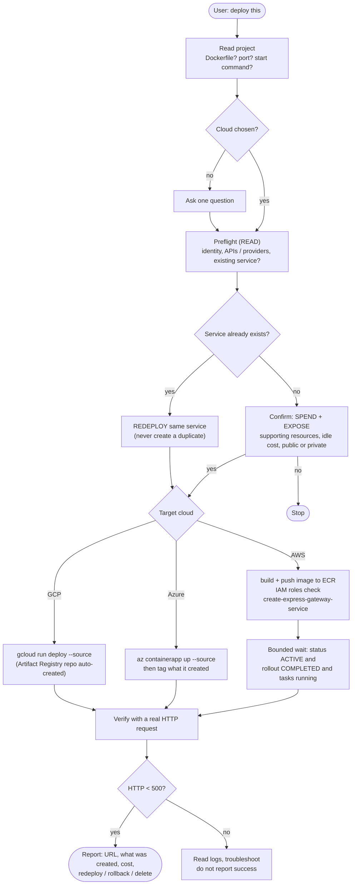

# Deploy Flow

Applies to [`cloudops-deploy`](../../skills/cloudops-deploy/SKILL.md). Decision record: [ADR-0004](../adr/ADR-0004-aws-default-deploy-target-ecs-express.md).

AWS differs from the others: Express Mode takes **images only** (no source build), needs two IAM roles, and does not scale to zero. App Runner has been closed to new customers since 2026-04-30.
