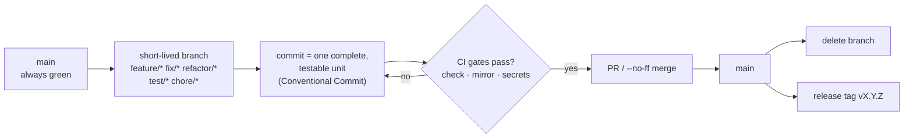

# Git Workflow (GitHub Flow)

Decision record: [ADR-0006](../adr/ADR-0006-git-workflow-github-flow.md).

Commit format: `<type>(<scope>): <subject>` with types `feat`, `fix`, `test`, `refactor`, `docs`, `chore`. A skill-only change that cannot satisfy the cross-reference gate on its own (see the dependency findings in [`../architecture/overview.md`](../architecture/overview.md)) is validated at the PR, not per commit.
