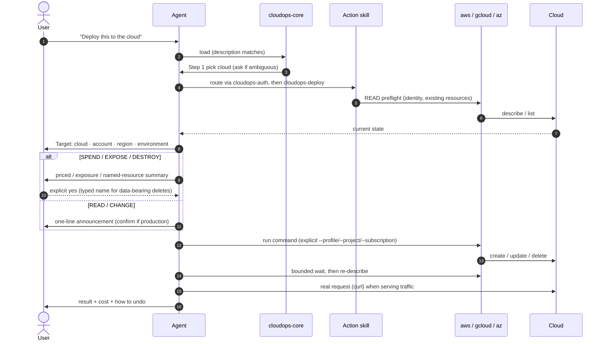

# Request Lifecycle

How one natural-language request becomes CLI calls. Source of truth: [`cloudops-core`](../../skills/cloudops-core/SKILL.md). Rules: [ADR-0003](../adr/ADR-0003-safety-model-action-classes.md).

Invariants: the target is stated before any change; confirmation-bypass flags (`--yes`, `--quiet`, `--force`) run only after the user said yes; a timed-out create/delete is never retried before looking at the current state.
